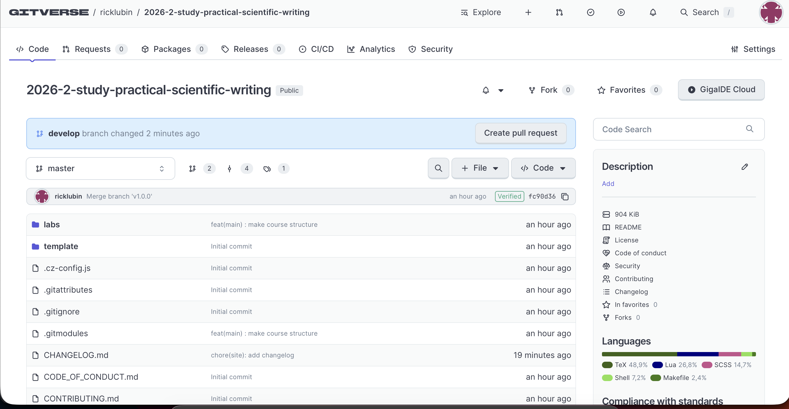

---
## Author
author:
  name: Lubin Rick Tienson
  degrees: BSc
  orcid: 0000-0000-0000-0000
  email: ricktiensonlubin@gmail.com
  affiliation:
    - name: Российский университет дружбы народов
      country: Российская Федерация
      postal-code: 117198
      city: Москва
      address: ул. Миклухо-Маклая, д. 6
## Title
title: лабораторной работе №1 презентация
subtitle: Practical Scientific Writing
license: CC BY
date: today
date-format: "YYYY-MM-DD" 
---

# Информация

## Докладчик

:::::::::::::: {.columns align=center}
::: {.column width="70%"}

  * Lubin Rick Tienson
  * Student
  * кафедры теории вероятностей и кибербезопасности
  * Российский университет дружбы народов им. П. Лумумбы
  * [ricktiensonlubin@gmail.com](mailto:ricktiensonlubin@gmail.com)

:::
::: {.column width="30%"}


:::
::::::::::::::


## Abstract
В лабораторной работе выполнена подготовка рабочего окружения для курса
  Настроена система контроля версий Git, созданы SSH- и PGP-ключи, настроено автоматическое подписание коммитов, подготовлены учётные записи GitVerse и SourceCraft. Установлены и настроены инструменты, необходимые для работы с репозиторием и
  семантическим версионированием. На основе предоставленного шаблона создано
  рабочее пространство курса, настроен Git Flow и сформирован первый релиз
  проекта версии 1.0.0.


## Введение

В данной лабораторной работе выполняется подготовка рабочего пространства Основное внимание уделяется настройке Git, SSH и PGP, работе с платформами GitVerse и
SourceCraft, организации структуры каталогов курса и использованию Git Flow.

## Актуальность

Подготовка такого окружения необходима для дальнейшего выполнения
лабораторных и научно-исследовательских работ в рамках курса.

## Цель работы

Цель лабораторной работы — подготовить и настроить рабочее окружение для
выполнения лабораторных работ по курсу

## Задачи

Для достижения поставленной цели необходимо выполнить следующие задачи:

1. Настроить систему контроля версий Git.
2. Создать SSH-ключ для доступа к удалённым Git-репозиториям.
3. Добавить SSH-ключ в GitVerse и SourceCraft.
4. Создать PGP-ключ для подписания коммитов.
5. Добавить публичный PGP-ключ в GitVerse и SourceCraft.
6. Настроить автоматическое подписание Git-коммитов.
7. Установить необходимые средства разработки.
8. Установить Node.js и средства работы с общепринятыми коммитами.
9. Установить и настроить Git Flow.
10. Создать репозиторий курса на основе предоставленного шаблона.
11. Инициализировать структуру рабочего пространства курса.
12. Настроить Git Flow для созданного репозитория.
13. Создать первый релиз проекта версии `1.0.0`.
14. Сформировать журнал изменений `CHANGELOG.md`.


## Система контроля версий Git

Git — распределённая система контроля версий, используемая для хранения
истории изменений проекта.

В данной работе Git используется для хранения файлов курса, создания
коммитов, организации веток и тегов, а также синхронизации проекта с
GitVerse и SourceCraft.


## Настройка Git

Сначала была выполнена базовая настройка Git. Были указаны имя и адрес
электронной почты пользователя:

```bash
git config --global user.name "Лубин Рик Тьенсон"
git config --global user.email "<email>"
```

Была настроена корректная работа с UTF-8:

```bash
git config --global core.quotepath false
```

В качестве начальной ветки была установлена ветка `master`:

```bash
git config --global init.defaultBranch master
```

Также были настроены параметры обработки окончаний строк:

```bash
git config --global core.autocrlf input
git config --global core.safecrlf warn
```

## Настройка GitVerse и SourceCraft

Для хранения репозитория были подготовлены учётные записи на платформах
GitVerse и SourceCraft.

GitVerse используется как один из удалённых серверов проекта, а SourceCraft
был добавлен как дополнительный удалённый репозиторий.

:::
::: {.column width="30%"}



:::
::::::::::::::

## Создание SSH-ключа

Для доступа к удалённым Git-репозиториям был создан SSH-ключ типа Ed25519:

```bash
ssh-keygen -t ed25519 -f ~/.ssh/id_ed25519-git -C "<email>"
```

После создания ключ был добавлен в SSH Agent:

```bash
ssh-add ~/.ssh/id_ed25519-git
```

Публичная часть SSH-ключа была добавлена через веб-интерфейсы GitVerse и
SourceCraft.

В результате появилась возможность выполнять операции `clone`, `fetch`,
`pull` и `push` через SSH.

## Создание PGP-ключа

Для подписания Git-коммитов был создан PGP-ключ:

```bash
gpg --full-generate-key
```

При генерации был выбран тип ключа RSA, размер ключа 4096 бит и указаны
данные владельца ключа.

Для получения информации о созданных секретных ключах была использована
команда:

```bash
gpg --list-secret-keys --keyid-format LONG
```

Из результата был получен отпечаток PGP-ключа.

Публичная часть ключа была экспортирована:

```bash
gpg --armor --export <PGP_FINGERPRINT>
```

Полученный публичный ключ был добавлен в настройки GitVerse и SourceCraft.

## Настройка автоматического подписания коммитов

Git был настроен на использование созданного PGP-ключа:

```bash
git config --global user.signingkey <PGP_FINGERPRINT>
git config --global commit.gpgsign true
git config --global gpg.program $(which gpg)
```

В процессе настройки была отдельно проверена работа GPG и механизм
`pinentry`. Для корректной передачи терминала GPG была настроена переменная
`GPG_TTY`.

После настройки Git получил возможность автоматически подписывать
создаваемые коммиты.

## Установка дополнительных инструментов

Для работы с Conventional Commits и семантическим версионированием была
подготовлена среда Node.js.

Для macOS Node.js устанавливается с помощью Homebrew:

```bash
brew install node
```

Для управления ветками по модели Git Flow был установлен Git Flow:

```bash
brew install git-flow
```

Также были подготовлены инструменты для работы с общепринятыми коммитами и
версиями проекта.

## Создание репозитория курса

На GitVerse был открыт репозиторий-шаблон:

```text
dharma/course-directory-student-template
```

## Инициализация структуры курса

После клонирования был выполнен переход в каталог репозитория.

Название курса было записано в файл `COURSE`:

```bash
echo practical-scientific-writing > COURSE
```


## Добавление SourceCraft

На платформе SourceCraft был создан репозиторий с тем же названием:

```text
2026-2-study-practical-scientific-writing
```

Он был добавлен к локальному Git-репозиторию как дополнительный remote:

```bash
git remote add src ssh://ssh.sourcecraft.dev/<owner>/2026-2-study-practical-scientific-writing.git
```

После этого ветка `master` была отправлена в SourceCraft:

```bash
git push src master
```

Таким образом, один локальный репозиторий был связан с двумя удалёнными
хранилищами.

## Настройка Git Flow

В созданном репозитории был инициализирован Git Flow:

```bash
git flow init
```

Для тегов релизов был установлен префикс:

```text
v
```

После инициализации была проверена текущая ветка:

```bash
git branch
```

Работа продолжилась в ветке `develop`.

Ветки репозитория были отправлены на удалённый сервер:

```bash
git push -u --all
```

## Создание релиза 1.0.0

Для подготовки первого релиза была создана release-ветка:

```bash
git flow release start 1.0.0
```

В результате Git Flow создал ветку:

```text
release/1.0.0
```

После этого был сформирован журнал изменений:

```bash
standard-changelog --first-release
```

Файл `CHANGELOG.md` был добавлен в индекс и зафиксирован:

```bash
git add CHANGELOG.md
git commit -am 'chore(site): add changelog'
```

## Завершение релиза

После подготовки журнала изменений релиз был завершён:

```bash
git flow release finish 1.0.0
```

При завершении Git Flow изменения из release-ветки были интегрированы в
основные ветки проекта, а для версии был создан соответствующий Git-тег.

После этого изменения были отправлены на удалённый сервер:

```bash
git push --all
git push --tags
```

Отдельно была выполнена отправка веток и тегов в настроенный репозиторий
SourceCraft.

Наличие тегов на удалённых серверах проверялось через веб-интерфейсы
GitVerse и SourceCraft.

## Подготовка данных релиза

Для материалов релиза был создан отдельный каталог:

```bash
mkdir -p ../release
```

Журнал изменений был скопирован в него:

```bash
cp CHANGELOG.md ../release
```

На GitVerse релиз версии `v1.0.0` был создан вручную через веб-интерфейс на
основе опубликованного Git-тега.

## Результаты

В результате выполнения лабораторной работы было подготовлено рабочее
окружение курса «Computer Skills for Scientific Writing».


## Заключение

В ходе выполнения лабораторной работы была достигнута поставленная цель —
подготовлено рабочее окружение для выполнения лабораторных работ по курсу
