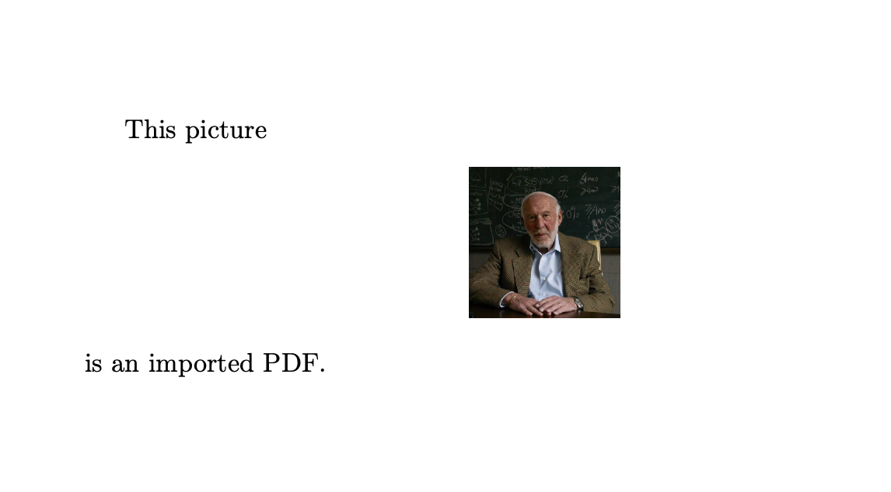
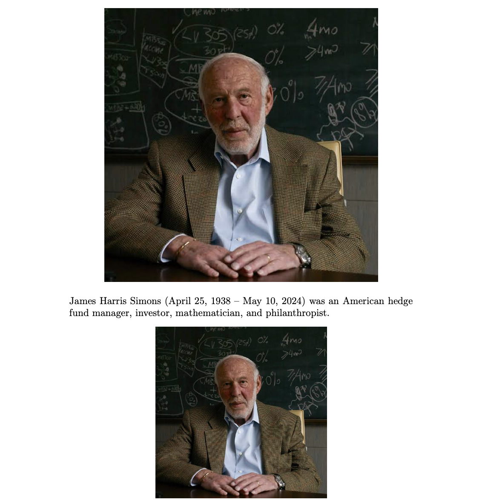
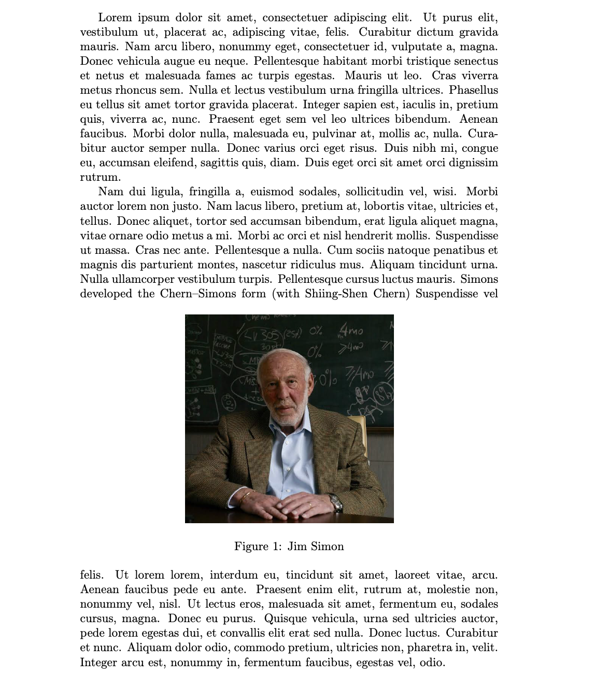
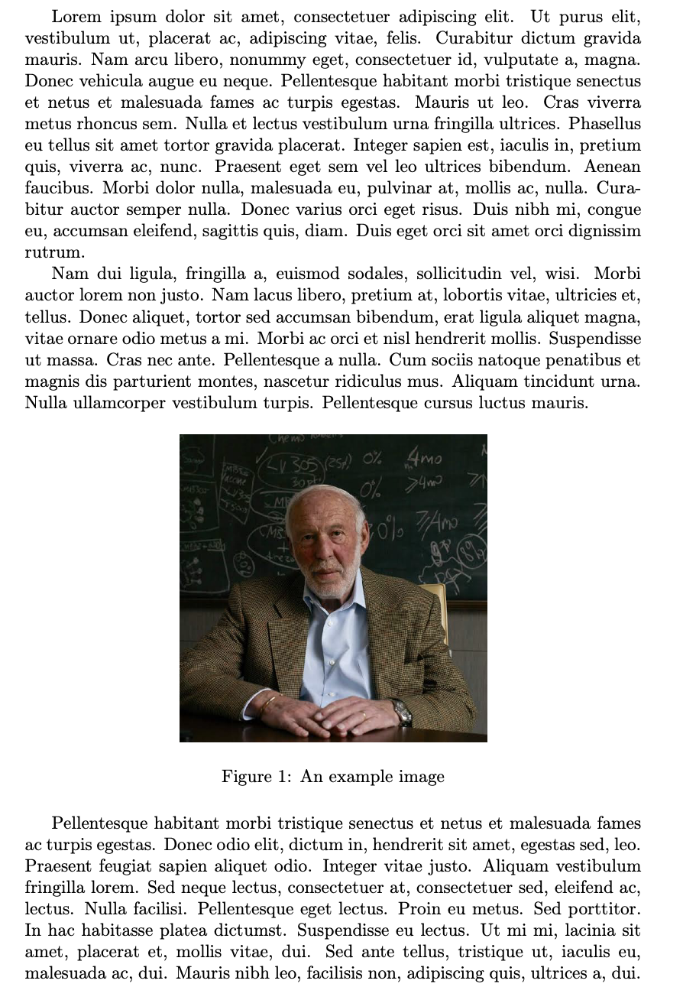
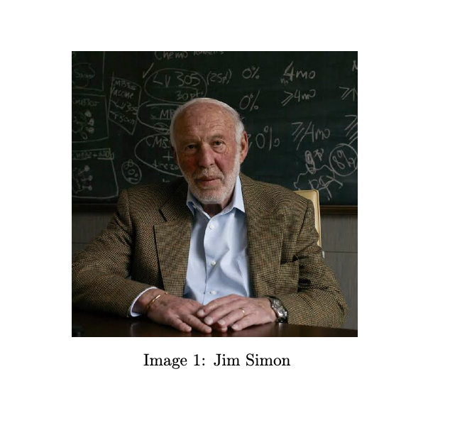
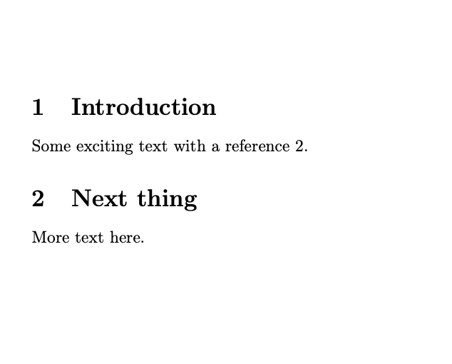

---
## Author
author:
  name: Лубин Рик Тьенсон
  degrees: Магистратура
  orcid: 0000-0000-0000-0000
  email: ricktiensonlubin@gmail.com
  affiliation:
    - name: Российский университет дружбы народов
      country: Российская Федерация
      postal-code: 117198
      city: Москва
      address: ул. Миклухо-Маклая, д. 6
## Title
title: Презентация по лабораторной работе №4
subtitle: Including Graphics
license: CC BY
date: today
date-format: "YYYY-MM-DD" # Example: 2025-09-06
---

# Информация

## Докладчик

:::::::::::::: {.columns align=center}
::: {.column width="70%"}

  * Лубин Рик Тьенсон
  * Магистратура
  * кафедры теории вероятностей и кибербезопасности
  * Российский университет дружбы народов им. П. Лумумбы
  * [ricktiensonlubin@gmail.com](mailto:ricktiensonlubin@gmail.com)
  * <https://gitverse.ru/dashboard>

:::
::: {.column width="30%"}


:::
::::::::::::::

::: notes
- Добрый день, уважаемые коллеги!
- В данном отчёте представлены результаты выполнения лабораторной работы по теме "Включая графику в LaTeX"
:::

# Вводная часть

## Актуальность

- В современной научной и технической документации значительную часть содержания составляют иллюстрации: схемы, графики, фотографии, скриншоты.
- Использование специализированного инструментария LaTeX для работы с внешней графикой позволяет отделить содержание изображения от его оформления
- освоение пакета graphicx и команды \includegraphics является практически значимым навыком для любого студента


## Объект и предмет исследования

- Объект — процесс подготовки научно-технической документации средствами LaTeX.
- Предмет — механизмы включения внешней графики в документы LaTeX и управление её отображением.


## Цели и задачи

- Цель:
    - Освоить подключение внешней графики в документах LaTeX с помощью пакета graphicx: научиться использовать команду \includegraphics для вставки изображений различных форматов (PNG, JPG, PDF, EPS)
- Задачи:
    1. Altering graphic appearance
    2. Making images float
    3. Naming graphics files
    4. Storing graphics in a subdirectory
    5. Producing graphics
    6. Placing floats
    7. Other types of float
    8. Cross-referencing


## Материалы и методы
- персональный компьютер под управлением ОС `MacOS`.
- дистрибутив TeX Live, компилятор pdflatex, текстовый редактор с поддержкой `LaTeX`
- Система контроля версий `git` и хостинг репозиториев `GitHub`
- - Редактор кода `VS Code` с расширением `Quarto`
- Процессор `pandoc` (как часть `quarto`) для входного формата Markdown
- Результирующие форматы
	- `pdf`
	- `html`
- Автоматизация процесса создания: `Makefile`


# Выполнение лабораторной работы

## Пакет `graphicx`

```LaTeX
\documentclass{article}
\usepackage[T1]{fontenc}
\usepackage{graphicx}
\begin{document}
This picture
\begin{center}
\includegraphics[height=2cm]{image_1.png}
\end{center}
is an imported PDF.
\end{document}
```
##

{#fig-001 width=70%}

## Altering graphic appearance

```LaTeX
\documentclass{article}
\usepackage[T1]{fontenc}
\usepackage{graphicx}
\begin{document}
\begin{center}
\includegraphics[height = 0.5\textheight]{example-image}
\end{center}
Some text
\begin{center}
\includegraphics[width = 0.5\textwidth]{example-image}
\end{center}
\end{document}
```
##
{#fig-002 width=70%}

## Making images float

```LaTeX
\documentclass{article}
\usepackage[T1]{fontenc}
\usepackage{graphicx}
\usepackage{lipsum} % produce dummy text as filler
\begin{document}
\lipsum[1-4] % Just a few filler paragraphs
Test location.
\begin{figure}[ht]
\centering
\includegraphics[width=0.5\textwidth]{example-image-a.png}
\caption{An example image}
\end{figure}
\lipsum[6-10] % Just a few filler paragraphs
\end{document}
```
##
{#fig-003 width=70%}

## Storing graphics in a subdirectory

```LaTeX
\graphicspath{{figs/}{pics/}}
```


## Placing floats
```LaTeX
\documentclass{article}
\usepackage[T1]{fontenc}
\usepackage{graphicx}
\usepackage{lipsum} \usepackage{float}
% dummy text for filler
\begin{document}
\lipsum[1-7]
\begin{figure}[H]
\centering
\includegraphics[width=0.5\textwidth]{example-image}
\caption{An example image}
\end{figure}
\lipsum[8-15]
\end{document}
```
##
{#fig-003 width=70%}

## Types of float

```LaTeX
\documentclass{article}
\usepackage[T1]{fontenc}
\usepackage{graphicx}
\usepackage{lipsum} % dummy text for filler
\usepackage{trivfloat}
\trivfloat{image}
\begin{document}
\begin{image}
\centering
\includegraphics[width=0.5\textwidth]{example-image}
\caption{An example image}
\end{image}
\end{document}
```
##
{#fig-003 width=70%}

## Making cross-references into links

```LaTeX
\documentclass{article}
\usepackage[T1]{fontenc}
\usepackage[hidelinks]{hyperref}
\begin{document}
\section{Introduction}
Some exciting text with a reference~\ref{sec:next}.
\section{Next thing}
\label{sec:next}
More text here.
\end{document}
```
##
{#fig-003 width=70%}

# Результаты
В ходе выполнения работы были получены следующие результаты:

- Пакет graphicx успешно подключён, команда \includegraphics работает корректно.

- Изображение формата JPG включено в документ с заданной шириной 70% от ширины текстового блока.

- Изображение размещено в плавающем окружении figure с подписью и меткой.

- Перекрёстная ссылка на рисунок корректно разрешается после повторной компиляции.

- Экспериментально подтверждена работа параметров width, height, scale, angle, trim, clip.

- Настройка \graphicspath позволила сократить запись пути к графическим файлам.

## Обсуждение результатов

Полученные результаты соответствуют теоретическим ожиданиям, изложенным в документации пакета graphicx:
- Параметр width позволяет гибко управлять размером изображения относительно ширины текста, что обеспечивает корректное размещение рисунков на странице.

- Использование textwidth и linewidth даёт практически одинаковый результат в одноколоночной вёрстке, однако различие становится заметным при использовании опции twocolumn.

- Плавающие окружения figure позволяют LaTeX автоматически выбирать оптимальное место для рисунка, избегая больших пустых промежутков.

- Опция H пакета float обеспечивает точное позиционирование, но может приводить к появлению пустого пространства.

- Механизм label ref требует как минимум двух компиляций для корректного разрешения ссылок, что связано с использованием вспомогательного файла.

- Настройка graphicspath упрощает работу с большим количеством графических файлов и делает документ более переносимым.


# Заключение

## Главный вывод
В ходе выполнения лабораторной работы были получены следующие результаты:

- Достигнута поставленная цель: освоено подключение внешней графики в документах LaTeX с помощью пакета graphicx.
- Изучена команда \includegraphics и её основные параметры (width, height, scale, angle, trim, clip, keepaspectratio).
- Освоено размещение изображений в плавающих окружениях figure и управление их положением.
- Изучен механизм перекрёстных ссылок `label` `ref` и настройка путей к графическим файлам через \graphicspath.
- Выполнено практическое задание по включению изображения в отчёт с подписью и ссылкой.
