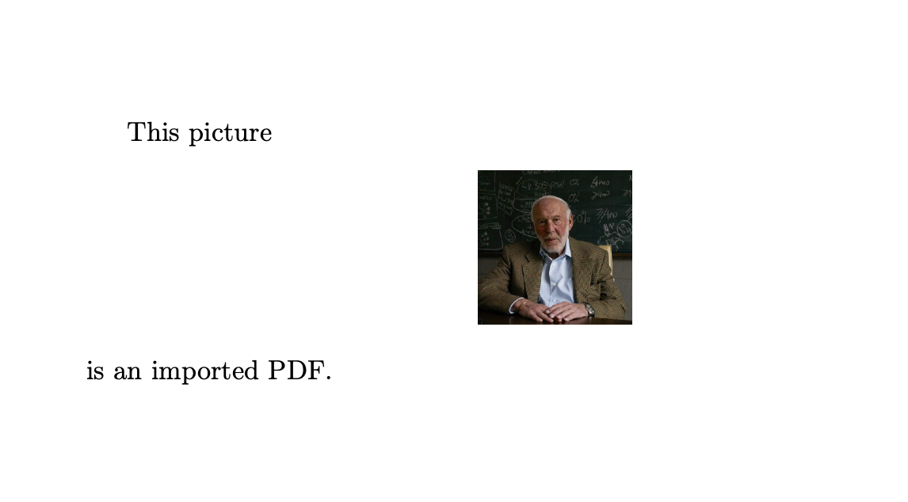
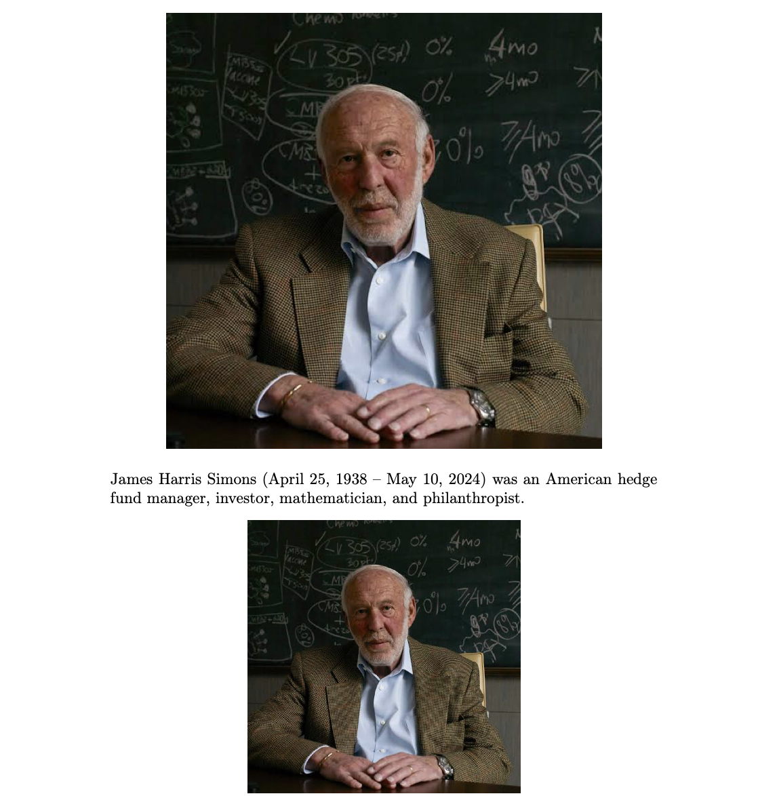
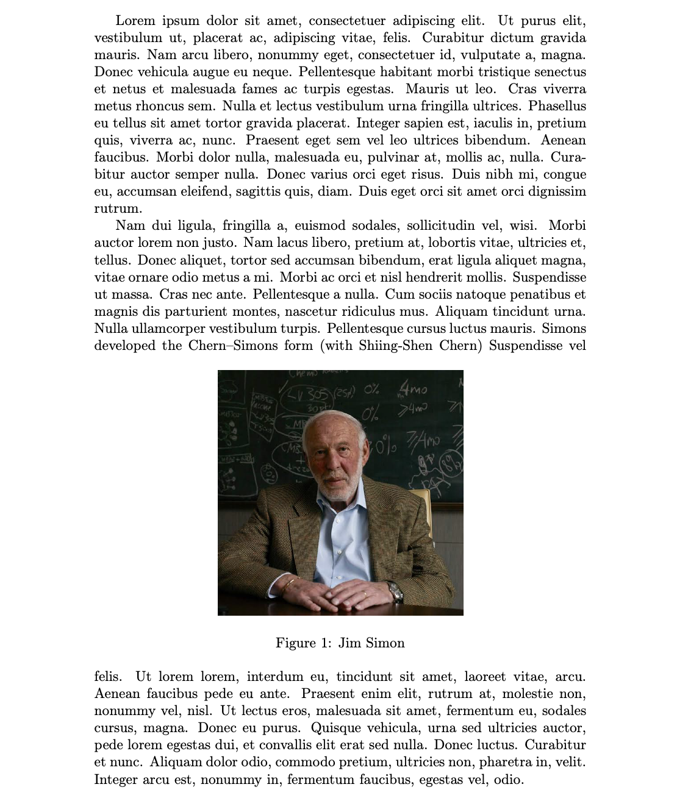
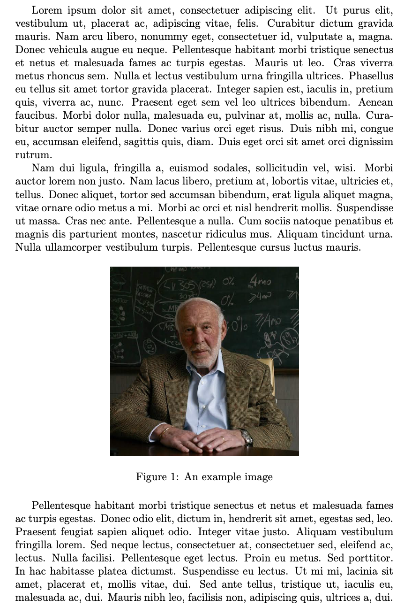
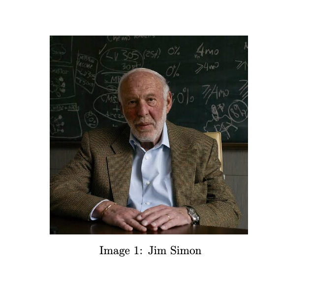
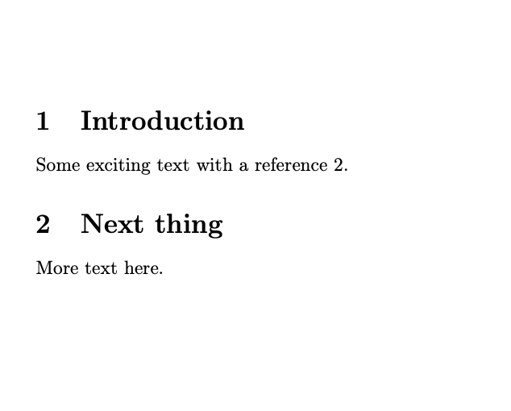

---
## Author
author:
  name: Лубин Рик Тьенсон
  degrees: Магистратура
  orcid: 0000-0000-0000-0000
  email: 
  affiliation:
    - name: Российский университет дружбы народов
      country: Российская Федерация
      postal-code: 117198
      city: Москва
      address: ул. Миклухо-Маклая, д. 6

## Title
title: "Отчёт по лабораторной работе №4"
subtitle: "Including Graphics"
license: "CC BY"
abstract: |
  В данном отчёте представлены результаты выполнения лабораторной работы по теме "Включая графику в LaTeX"

keywords: [Altering graphic, Images float, Producing graphics, Cross-referencing]
---

# Введение

## Актуальность

В современной научной и технической документации значительную часть содержания составляют иллюстрации: схемы, графики, фотографии, скриншоты. Подготовка отчётов по лабораторным работам невозможна без корректного включения внешних изображений в документ. При этом ручное управление размером, положением и оформлением рисунков приводит к ошибкам: изображения выходят за поля, теряют пропорции, дублируются или не компилируются вовсе.

Использование специализированного инструментария LaTeX[@latex_doc] для работы с внешней графикой позволяет отделить содержание изображения от его оформления и обеспечить единообразие документов. Поэтому освоение пакета graphicx и команды \includegraphics является практически значимым навыком для любого студента, готовящего отчёты и научные публикации.

## Цель работы

Освоить подключение внешней графики в документах LaTeX с помощью пакета graphicx: научиться использовать команду \includegraphics для вставки изображений различных форматов (PNG, JPG, PDF, EPS), управлять их масштабом, пропорциями и обрезкой посредством параметров (width, height, keepaspectratio, trim, clip), а также настраивать пути к файлам через \graphicspath и устранять типичные ошибки сборки, связанные с внешними графическими файлами.

## Задачи
 1. Altering graphic appearance
 2. Making images float
 3. Naming graphics files
 4. Storing graphics in a subdirectory
 5. Producing graphics
 6. Placing floats
 7. Other types of float
 8. Cross-referencing

## Объект и предмет исследования

Объект — процесс подготовки научно-технической документации средствами LaTeX. Предмет — механизмы включения внешней графики в документы LaTeX и управление её отображением.

## Методы исследования

Используются методы анализа документации пакета graphicx и практического эксперимента: создание тестовых документов, включение изображений различных форматов с разными наборами параметров, анализ результатов компиляции и сообщений об ошибках.

## Схема выполнения работы

На рис. -@fig-flowchart представлена общая последовательность действий при выполнении работы.


::: {#fig-flowchart}

```{mermaid}
%%| fig-width: 100%
graph TD
    A@{ shape: circle, label: "Начало" } --> B[Подключить пакет graphicx]
    B --> C[Подготовить графический файл]
    C --> D[Вставить \includegraphics с параметрами]
    D --> E[Поместить рисунок в окружение figure]
    E --> F[Добавить подпись и метку]
    F --> G[Сослаться на рисунок через \ref]
    G --> H[Скомпилировать документ]
    H --> I{Ошибки?}
    I -- Да --> J[Исправить пути, форматы, параметры]
    J --> H
    I -- Нет --> K@{ shape: dbl-circ, label: "Конец" }
```

Блок-схема выполнения лабораторной работы

:::

# Теоретическая часть [@practical_scientific_writing]

Здесь излагаются теоретические сведения, необходимые для понимания работы. Это может быть описание файловой системы, алгоритмов, физических законов и т.п.

в табл. -@tbl-std-dir приведено краткое описание объяснение каждой команды из лаборатории.

| Имя каталога                          | Описание каталога                                                                                                          |
|---------------------------------------|----------------------------------------------------------------------------------------------------------------------------|
| `\includegraphics`                    |   Чтобы использовать графику из-за пределов LaTeX, используйте пакет graphicx                                                |
| `\textwidth`                          | это ширина текстового блока на физической странице,                                                                        |
| `\linewidth`                          | это текущая ширина, которая может локально отличаться                                                                      |
| `\centering`                          | чтобы расположить изображение горизонтально по центру страницы.                                                            |
| `\graphicspath`                       | если у вас много графики, возможно, вам захочется заранее настроить подкаталог.Это можно сделать с помощью `graphicspath`  |
| `\trivfloat`                          | Возможно, вам захочется использовать другие типы плавающей среды; каждый тип вставляется независимо                        |
| `\label`                              | Команда `label` всегда ссылается на предыдущий пронумерованный объект: раздел,уравнение, число с плавающей точкой и т.д.   |
| `\ref`                                | Вторичная иерархия для данных пользователя                                                                                 |

: описание объяснение каждой команды из лаборатории {#tbl-std-dir}

Более подробно про LaTeX. в [@latex_doc].

# Материалы и методы

При выполнении работы использовались следующие материалы и инструменты:

Оборудование: персональный компьютер под управлением ОС MacOS. [@newham_book_learning-bash_en;@robbins_book_bash_en; @zarrelli_book_mastering-bash_en ]
Программное обеспечение: дистрибутив TeX Live, компилятор pdflatex, текстовый редактор с поддержкой LaTeX, система контроля версий Git[@chacon_progit_2014].
Графические файлы: изображения форматов PNG, JPG, PDF.


# Выполнение лабораторной работы

```LaTeX
\documentclass{article}
\usepackage[T1]{fontenc}
\usepackage{graphicx}
\begin{document}
This picture
\begin{center}
\includegraphics[height=2cm]{image_1.png}
\end{center}
is an imported PDF.
\end{document}
```
{#fig-001 width=70%}

4.1 Altering graphic appearance

```LaTeX
\documentclass{article}
\usepackage[T1]{fontenc}
\usepackage{graphicx}
\begin{document}
\begin{center}
\includegraphics[height = 0.5\textheight]{example-image}
\end{center}
Some text
\begin{center}
\includegraphics[width = 0.5\textwidth]{example-image}
\end{center}
\end{document}
```
{#fig-002 width=70%}

4.2 Making images float
```LaTeX
\documentclass{article}
\usepackage[T1]{fontenc}
\usepackage{graphicx}
\usepackage{lipsum} % produce dummy text as filler
\begin{document}
\lipsum[1-4] % Just a few filler paragraphs
Test location.
\begin{figure}[ht]
\centering
\includegraphics[width=0.5\textwidth]{example-image-a.png}
\caption{An example image}
\end{figure}
\lipsum[6-10] % Just a few filler paragraphs
\end{document}
```
{#fig-003 width=70%}

4.4 Storing graphics in a subdirectory

```LaTeX
\graphicspath{{figs/}{pics/}}
```


4.6 Placing floats

```LaTeX
\documentclass{article}
\usepackage[T1]{fontenc}
\usepackage{graphicx}
\usepackage{lipsum} \usepackage{float}
% dummy text for filler
\begin{document}
\lipsum[1-7]
\begin{figure}[H]
\centering
\includegraphics[width=0.5\textwidth]{example-image}
\caption{An example image}
\end{figure}
\lipsum[8-15]
\end{document}
```

{#fig-003 width=70%}

4.7 Other types of float
```LaTeX
\documentclass{article}
\usepackage[T1]{fontenc}
\usepackage{graphicx}
\usepackage{lipsum} % dummy text for filler
\usepackage{trivfloat}
\trivfloat{image}
\begin{document}
\begin{image}
\centering
\includegraphics[width=0.5\textwidth]{example-image}
\caption{An example image}
\end{image}
\end{document}
```
{#fig-003 width=70%}

Making cross-references into links

```LaTeX
\documentclass{article}
\usepackage[T1]{fontenc}
\usepackage[hidelinks]{hyperref}
\begin{document}
\section{Introduction}
Some exciting text with a reference~\ref{sec:next}.
\section{Next thing}
\label{sec:next}
More text here.
\end{document}
```
{#fig-003 width=70%}

# Результаты
В ходе выполнения работы были получены следующие результаты:

- Пакет graphicx успешно подключён, команда \includegraphics работает корректно.

- Изображение формата JPG включено в документ с заданной шириной 70% от ширины текстового блока.

- Изображение размещено в плавающем окружении figure с подписью и меткой.

- Перекрёстная ссылка на рисунок корректно разрешается после повторной компиляции.

- Экспериментально подтверждена работа параметров width, height, scale, angle, trim, clip.

- Настройка \graphicspath позволила сократить запись пути к графическим файлам.

# Обсуждение результатов

Полученные результаты соответствуют теоретическим ожиданиям, изложенным в документации пакета graphicx:
- Параметр width позволяет гибко управлять размером изображения относительно ширины текста, что обеспечивает корректное размещение рисунков на странице.

- Использование textwidth и linewidth даёт практически одинаковый результат в одноколоночной вёрстке, однако различие становится заметным при использовании опции twocolumn.

- Плавающие окружения figure позволяют LaTeX автоматически выбирать оптимальное место для рисунка, избегая больших пустых промежутков.

- Опция H пакета float обеспечивает точное позиционирование, но может приводить к появлению пустого пространства.

- Механизм label ref требует как минимум двух компиляций для корректного разрешения ссылок, что связано с использованием вспомогательного файла.

- Настройка graphicspath упрощает работу с большим количеством графических файлов и делает документ более переносимым.


# Заключение
В ходе выполнения лабораторной работы были получены следующие результаты:

- Достигнута поставленная цель: освоено подключение внешней графики в документах LaTeX с помощью пакета graphicx.
- Изучена команда \includegraphics и её основные параметры (width, height, scale, angle, trim, clip, keepaspectratio).
- Освоено размещение изображений в плавающих окружениях figure и управление их положением.
- Изучен механизм перекрёстных ссылок `label` `ref` и настройка путей к графическим файлам через \graphicspath.
- Выполнено практическое задание по включению изображения в отчёт с подписью и ссылкой.

# Список литературы {.unnumbered}

::: {#refs}
:::

\appendix

