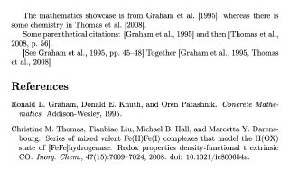
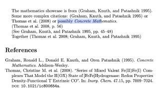
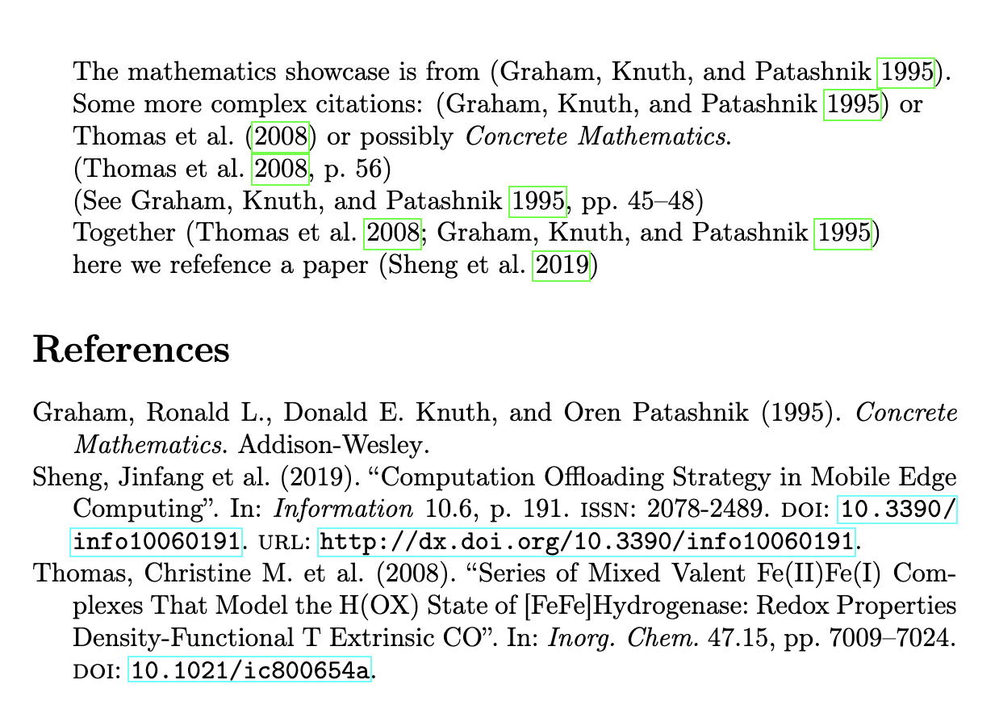
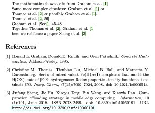

---
## Author
author:
  - name: Лубин Рик Тьенсон
    degrees: Магистратура
    email: 1132259429@rudn.ru
    affiliation:
      - name: Российский университет дружбы народов
        country: Российская Федерация
        postal-code: 117198
        city: Москва
        address: ул. Миклухо-Маклая, д. 6
title: "Работа с библиографией в LaTeX"
subtitle: "Computer Skills for Scientific Writing — Лабораторная работа №6"
license: CC BY
date: today
date-format: "YYYY-MM-DD"
---

# Информация

## Докладчик

:::: {.columns align=center}
::: {.column width="70%"}

- Лубин Рик Тьенсон
- Магистрант
- Российский университет дружбы народов им. П. Лумумбы
- [1132259429@rudn.ru](mailto:1132259429@rudn.ru)

:::
::: {.column width="30%"}


:::
::::

# Вводная часть

## Актуальность

- Научная работа требует корректных ссылок на публикации и единого оформления списка литературы.
- Ручное редактирование ссылок затрудняет изменение стиля и обновление библиографии.
- LaTeX использует отдельную базу `.bib`, из которой автоматически формируются цитирования и список литературы.

## Объект и предмет исследования

- **Объект:** подготовка научных и технических документов в LaTeX.
- **Предмет:** управление библиографическими базами, ссылками, стилями и сортировкой источников.

## Цель и задачи

**Цель:** освоить создание и использование библиографии в LaTeX.

**Задачи:**

- Создать базу данных `.bib`.
- Использовать `natbib` с BibTeX и `biblatex` с Biber.
- Сравнить текстовые, скобочные и числовые ссылки.
- Изучить сортировку Unicode и гиперссылки.
- Выполнить упражнения из раздела 6.9 пособия.

## Материалы и методы

- **Материалы:** компьютер, LaTeX, редактор кода, файлы `.tex` и `.bib`, учебное пособие *Practical Scientific Writing*, глава 6, с. 109–115.
- **Методы:** изучение примеров, составление библиографической базы, сравнение команд и стилей, анализ последовательности компиляции.
- **Примечание:** ниже приведены воспроизводимые примеры; фактические результаты компиляции необходимо проверить в LaTeX.

# Выполнение лабораторной работы

## Общая схема работы с библиографией

```{mermaid}
flowchart TD
  A[Создать записи в файле .bib] --> B[Написать документ .tex]
  B --> C[Указать ключи цитирования]
  C --> D{Выбрать систему}
  D --> E[BibTeX + natbib]
  D --> F[Biber + biblatex]
  E --> G[Скомпилировать и сформировать список]
  F --> G
```

## Библиографическая база `.bib` — раздел 6.1

- Один файл `.bib` может содержать множество источников.
- Каждая запись начинается с типа, например `@article` или `@book`.
- **Ключ цитирования** — идентификатор записи, например `Thomas2008`.
- Поля имеют форму `author = {...}` и `year = {...}`.

## Пример записи научной статьи

```bibtex
@article{Thomas2008,
  author  = {Thomas, Christine M. and Liu, Tianbiao and
             Hall, Michael B. and Darensbourg, Marcetta Y.},
  title   = {Series of Mixed Valent {Fe(II)Fe(I)} Complexes
             That Model the {H(OX)} State of [{FeFe}]Hydrogenase},
  journal = {Inorg. Chem.},
  year    = {2008},
  volume  = {47},
  number  = {15},
  pages   = {7009--7024},
  doi     = {10.1021/ic800654a}
}
```

*Фрагмент названия сокращён для удобства слайда; для точной записи используйте полный заголовок из учебного пособия.*

## Пример записи книги

```bibtex
@book{Graham1995,
  author    = {Ronald L. Graham and Donald E. Knuth
               and Oren Patashnik},
  title     = {Concrete Mathematics},
  publisher = {Addison-Wesley},
  year      = {1995}
}
```

- Авторы отделяются словом `and`.
- Фигурные скобки внутри заголовков сохраняют нужный регистр символов.

## Инструменты для работы с `.bib`

- **JabRef:** редактор библиографических записей.
- **doi2bib:** получение черновой BibTeX-записи по DOI.
- Записи, полученные автоматически, нужно проверять: авторов, название, год, журнал, DOI.

## Перенос информации в документ — раздел 6.2

```{mermaid}
flowchart LR
  A[LaTeX] --> B[Список использованных ключей]
  B --> C[BibTeX или Biber]
  C --> D[Данные и порядок источников]
  D --> E[Повторный запуск LaTeX]
  E --> F[Готовые ссылки]
```

- Система обработки библиографии выбирает только нужные записи и применяет стиль.
- Для разрешения ссылок обычно нужны дополнительные запуски LaTeX.

## BibTeX + `natbib` — раздел 6.3

```latex
\documentclass{article}
\usepackage[T1]{fontenc}
\usepackage{natbib}
\begin{document}
The mathematics showcase is from \citet{Graham1995}.
Some chemistry appears in \citep{Thomas2008}.
\bibliographystyle{plainnat}
\bibliography{references}
\end{document}
```

Файл `references.bib` должен находиться рядом с `.tex`.

{#fig-001 width=70%}
{#fig-002 width=70%}
## Текстовые и скобочные ссылки

| Команда | Назначение |
|---|---|
| `\citet{Graham1995}` | Автор как часть предложения |
| `\citep{Graham1995}` | Автор и год в скобках |
| `\citep[p.~56]{Thomas2008}` | Ссылка с номером страницы |
| `\citep[See][pp.~45--48]{Graham1995}` | Примечание до ссылки и страницы после |
| `\citep{Graham1995,Thomas2008}` | Несколько источников |

## Стили `natbib`

```latex
% Стиль автор–год
\usepackage{natbib}
\bibliographystyle{plainnat}

% Для числовых ссылок измените подключение пакета:
\usepackage[numbers]{natbib}
```

- `\bibliographystyle{...}` выбирает `.bst`-стиль.
- `\bibliography{references}` подключает базу без расширения `.bib`.

## Порядок компиляции с BibTeX

```text
pdflatex main.tex
bibtex main
pdflatex main.tex
pdflatex main.tex
```

**Важно:** команда `bibtex` получает имя основного документа без расширения, а не имя файла `.bib`.

## Biber + `biblatex` — раздел 6.4

```latex
\documentclass{article}
\usepackage[T1]{fontenc}
\usepackage[backend=biber,style=authoryear]{biblatex}
\addbibresource{references.bib}
\begin{document}
The mathematics showcase is from \autocite{Graham1995}.
More chemistry: \textcite{Thomas2008}.
\printbibliography
\end{document}
```
{#fig-003 width=70%}
{#fig-005 width=70%}
## Команды `biblatex`

| Команда | Назначение |
|---|---|
| `\autocite{Graham1995}` | Автоматически форматируемая ссылка |
| `\parencite{Graham1995}` | Ссылка в скобках |
| `\textcite{Thomas2008}` | Текстовая ссылка |
| `\citetitle{Graham1995}` | Название источника |
| `\autocite[56]{Thomas2008}` | Ссылка на страницу |
| `\autocite[See][45-48]{Graham1995}` | Дополнительные примечания |

## Порядок компиляции с Biber

```text
pdflatex main.tex
biber main
pdflatex main.tex
pdflatex main.tex   # при необходимости
```

- База подключается в преамбуле: `\addbibresource{references.bib}`.
- Список литературы выводится в теле: `\printbibliography`.
- Стиль задаётся параметром `style=authoryear` или `style=numeric`.

## Сравнение двух систем — раздел 6.5

| Критерий | BibTeX + natbib | Biber + biblatex |
|---|---|---|
| Стиль | `.bst` + `\bibliographystyle` | `style=...` |
| База | `\bibliography{references}` | `\addbibresource{references.bib}` |
| Список | `\bibliography` | `\printbibliography` |
| Настройка | Обычно через `.bst` | Гибче из LaTeX |
| Unicode-сортировка | Ограниченная | Полная поддержка |

## Как выбрать систему?

- Если издательство требует файл `.bst`, используйте **BibTeX**.
- Для простых ссылок и англоязычной библиографии часто достаточно **natbib**.
- Для сложных стилей, гибкой настройки и неанглоязычной сортировки удобнее **biblatex + Biber**.
- При подготовке статьи всегда проверяйте требования журнала.

## Сортировка неанглоязычных источников — раздел 6.6

- BibTeX ориентирован на US-ASCII и имеет ограничения при обработке кириллицы и других письменностей.
- Biber обеспечивает сортировку Unicode.
- Для многоязычной библиографии предпочтителен `biblatex` с Biber.

```latex
\usepackage[backend=biber,style=authoryear,
            sorting=nyt]{biblatex}
```

## Гиперссылки — раздел 6.7

```latex
\usepackage{hyperref}
```

- Пакет `hyperref` позволяет создавать активные ссылки в PDF.
- Особенно полезен для адресов URL и идентификаторов DOI в библиографии.

## Поля и совместимость стилей — раздел 6.8

- Формат `.bib` общий, но поддерживаемые поля зависят от выбранного стиля.
- Старые `.bst`-стили, например `plain.bst`, могут игнорировать поле `url`.
- Некоторые старые стили используют `howpublished` как обходной вариант.
- Перед сдачей документа следует проверить, какие поля реально выводит стиль.

## Упражнение 1 — запуск двух примеров

**Задание (раздел 6.9):** выполнить примеры `natbib` и `biblatex`.

- Для `natbib`: LaTeX → BibTeX → LaTeX → LaTeX.
- Для `biblatex`: LaTeX → Biber → LaTeX (при необходимости повторить).
- Проверить, появились ли ссылки и список литературы.

## Упражнение 2 — новая запись и новая ссылка

Добавьте в `references.bib` собственную запись, например:

```bibtex
@book{Example2026,
  author    = {Ivanov, Ivan},
  title     = {Example Book},
  publisher = {Example Publisher},
  year      = {2026}
}
```

Затем вставьте в `.tex` команду `\citep{Example2026}` или `\autocite{Example2026}` и пересоберите документ.

*Запись условная и служит только для демонстрации синтаксиса.*

## Упражнение 3 — отсутствующий ключ

```latex
\citep{UnknownReference}
```

- Добавить ссылку на ключ, которого нет в `.bib`.
- Проверить предупреждения компилятора и отображение неразрешённой ссылки.
- Исправить ключ либо добавить недостающую запись.

## Упражнение 4 — числовые ссылки

```latex
% natbib:
\usepackage[numbers]{natbib}

% biblatex (в альтернативном документе):
\usepackage[backend=biber,style=numeric]{biblatex}
```
{#fig-005 width=70%}
- Сравнить формат цитирования в тексте.
- Убедиться, что стиль ссылок соответствует выбранной системе.

# Результаты

## Основные результаты изучения

- Рассмотрена структура библиографической базы `.bib`.
- Подготовлены примеры ссылок для `natbib` и `biblatex`.
- Сопоставлены команды цитирования, стили и последовательности компиляции.
- Сформулированы действия для четырёх упражнений раздела 6.9.

**Ограничение:** фактическая компиляция и её выходные файлы здесь не проверялись.

# Заключение

## Выводы

Работа с библиографией в LaTeX позволяет отделить данные об источниках от текста документа и автоматизировать оформление ссылок. Система **BibTeX + natbib** удобна для стандартных стилей и требований издательств; **Biber + biblatex** предоставляет более гибкую настройку и поддержку многоязычной сортировки. Выбор системы должен учитывать требования к публикации и используемый стиль библиографии.

## Источник

*Practical Scientific Writing*. Глава 6: **Working with bibliography**, разделы 6.1–6.9, с. 109–115.
