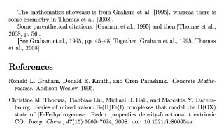
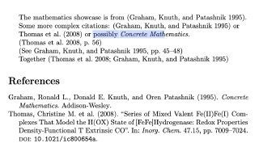
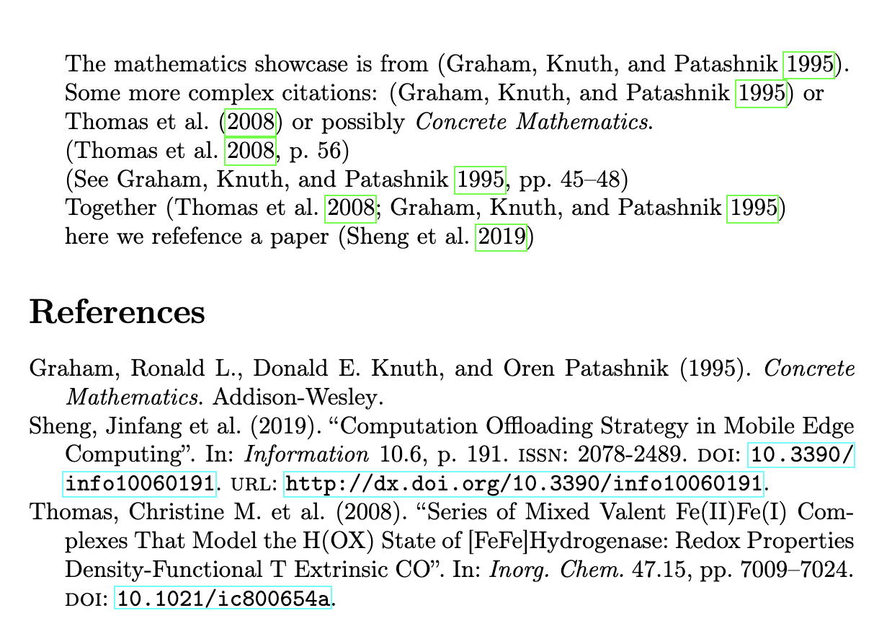

---
## Author
author:
  - name: Лубин Рик Тьенсон
    degrees: Магистратура
    email: 1132259429@rudn.ru
    affiliation:
      - name: Российский университет дружбы народов
        country: Российская Федерация
        postal-code: 117198
        city: Москва
        address: ул. Миклухо-Маклая, д. 6
title: "Отчёт по лабораторной работе №6"
subtitle: "Computer Skills for Scientific Writing — Working with Bibliography"
abstract: |
  Лабораторная работа посвящена организации библиографических данных и оформлению ссылок в LaTeX. На основе главы 6 учебного пособия *Practical Scientific Writing* (с. 109–115) рассмотрены файлы .bib, типы записей, ключи цитирования, рабочие процессы BibTeX с natbib и Biber с biblatex, стили ссылок, сортировка многоязычных источников и гиперссылки. Приведены воспроизводимые примеры и задания для самостоятельной проверки.
keywords: [LaTeX, BibTeX, Biber, natbib, biblatex, bibliography, citations]
---

# Введение

## Актуальность

Научные тексты требуют точных ссылок на публикации и единообразно оформленного списка литературы. При ручном вводе библиографических сведений возрастает риск опечаток, несогласованности ссылок и ошибок при изменении стиля оформления. LaTeX позволяет хранить сведения об источниках отдельно от основного текста в базе `.bib`[@latex_doc], автоматически выбирать цитируемые записи и формировать список литературы. Именно такой подход рассматривается в главе 6 учебного пособия [@practical_scientific_writing].

## Цель работы

Освоить создание библиографической базы `.bib` и научиться оформлять ссылки и список литературы в LaTeX двумя способами: с помощью **BibTeX + natbib** и **Biber + biblatex**.

## Задачи

- Изучить устройство библиографической базы и основные типы записей `@article` и `@book`.
- Научиться задавать ключи цитирования и поля `author`, `title`, `year`, `journal`, `publisher`, `doi`.
- Разобрать последовательность компиляции документа с BibTeX и Biber.
- Использовать текстовые и внутритекстовые ссылки через `\citet`, `\citep`, `\textcite`, `\parencite` и `\autocite`.
- Сравнить стили `plainnat`, `authoryear` и `numeric`.
- Исследовать особенности сортировки неанглоязычных источников и работы `hyperref`.
- Выполнить упражнения из раздела 6.9 учебного пособия (с. 115).

## Объект и предмет исследования

**Объект исследования:** подготовка научных документов в системе LaTeX.

**Предмет исследования:** создание библиографических баз, управление ссылками, настройка библиографических стилей и автоматическая генерация списка литературы.

## Методы исследования

Использованы анализ учебных примеров, практическое составление файлов `.bib` и `.tex`, сравнительный анализ двух систем библиографии и проверка предполагаемого поведения команд при компиляции. Примеры ниже представлены как инструкции для воспроизведения; результаты реальной компиляции в рамках этого отчёта не утверждаются без запуска LaTeX.

## Схема выполнения работы

На рис. @fig-flowchart показана последовательность выполнения лабораторной работы.

```{mermaid}
%%| label: fig-flowchart
%%| fig-cap: "Блок-схема выполнения лабораторной работы №6"
flowchart TD
    A([Начало]) --> B[Изучить разделы 6.1–6.9]
    B --> C[Создать базу references.bib]
    C --> D[Создать документ с natbib]
    D --> E[Компиляция LaTeX → BibTeX → LaTeX → LaTeX]
    E --> F[Создать документ с biblatex]
    F --> G[Компиляция LaTeX → Biber → LaTeX]
    G --> H[Сравнить стили и команды цитирования]
    H --> I[Проверить неизвестный ключ и новые записи]
    I --> J[Проверить Unicode и гиперссылки]
    J --> K[Оформить выводы и список литературы]
    K --> L([Конец])
```

# Теоретическая часть

## Библиографическая база данных (раздел 6.1, с. 109–110)

Библиографическая база — текстовый файл с расширением `.bib`, содержащий записи об источниках. Каждая запись начинается с типа (`@article`, `@book`), после которого указывается уникальный **ключ цитирования**. Поля записываются в формате `поле = {значение}`. В поле `author` имена разных авторов разделяются словом `and`; дополнительные фигурные скобки внутри заголовка защищают регистр букв от автоматического изменения стилем.

## Перенос данных из базы в документ (раздел 6.2, с. 111)

Общий принцип состоит из трёх этапов: LaTeX определяет использованные ссылки, библиографический процессор выбирает нужные записи и упорядочивает их, затем LaTeX повторно обрабатывает документ для разрешения ссылок. Для рабочего процесса `natbib` используется BibTeX, а для рассматриваемого варианта `biblatex` — Biber.

## Сравнение команд и инструментов

| Возможность | BibTeX + natbib | Biber + biblatex |
|:--|:--|:--|
| Подключение | `\usepackage{natbib}` | `\usepackage[style=authoryear]{biblatex}` |
| Текстовая ссылка | `\citet{key}` | `\textcite{key}` |
| Ссылка в скобках | `\citep{key}` | `\parencite{key}` |
| Универсальная ссылка | — | `\autocite{key}` |
| Выбор стиля | `\bibliographystyle{plainnat}` | параметр `style=...` |
| Подключение базы | `\bibliography{references}` | `\addbibresource{references.bib}` |
| Вывод списка | `\bibliography{references}` | `\printbibliography` |
| Библиографический процессор | BibTeX | Biber |
| Сортировка Unicode | ограниченная | поддерживается Biber |

: Сравнение двух рабочих процессов по разделам 6.3–6.6 {#tbl-comparison}

## Выбор рабочего процесса (разделы 6.5–6.6, с. 113–114)

Если издатель предоставляет файл стиля `.bst`, следует использовать BibTeX. Для сложных форматов ссылок, расширенной настройки и корректной сортировки многоязычных источников предпочтительнее `biblatex` с Biber. При подготовке публикации решающими остаются требования журнала или издательства [@practical_scientific_writing].

## Гиперссылки и поля базы (разделы 6.7–6.8, с. 115)

Пакет `hyperref` позволяет создавать активные ссылки, в том числе для DOI и URL в библиографии. Набор поддерживаемых полей зависит от библиографического стиля: некоторые старые `.bst`-стили не поддерживают поле `url`, в отличие от многих современных стилей. Поэтому нужно проверять документацию выбранного стиля.

# Материалы и методы

**Материалы:** учебное пособие *Practical Scientific Writing*, глава 6, с. 109–115 [@practical_scientific_writing]; компьютер; установленный дистрибутив LaTeX с BibTeX и Biber; редактор `.tex` и `.bib` (например, VS Code[@vscode] или Overleaf[@github_doc]).

**Методика:** создание общей базы данных, подготовка двух минимальных документов, выполнение компиляции в указанном порядке, наблюдение за результатами изменения стилей и ключей цитирования.

# Выполнение лабораторной работы

## 1. Создание базы библиографических записей

Создадим файл `references.bib`. Ниже приведены две записи из учебного пособия: научная статья и книга.[@Thomas2008; @Graham1995]

```bibtex
@article{Thomas2008,
  author  = {Thomas, Christine M. and Liu, Tianbiao and Hall, Michael B. and Darensbourg, Marcetta Y.},
  title   = {Series of Mixed Valent {Fe(II)Fe(I)} Complexes That Model the {H(OX)} State of [{FeFe}]Hydrogenase: Redox Properties, Density-Functional Theory Investigation, and Reactivity with Extrinsic {CO}},
  journal = {Inorg. Chem.},
  year    = {2008},
  volume  = {47},
  number  = {15},
  pages   = {7009--7024},
  doi     = {10.1021/ic800654a}
}

@book{Graham1995,
  author    = {Ronald L. Graham and Donald E. Knuth and Oren Patashnik},
  title     = {Concrete Mathematics},
  publisher = {Addison-Wesley},
  year      = {1995}
}
```

**Разбор:** `Thomas2008` и `Graham1995` — идентификаторы, используемые в командах цитирования. `@article` содержит поля журнала, тома, номера и страниц; `@book` — издательство. Фигурные скобки внутри заголовка статьи сохраняют химические обозначения.

## 2. Оформление ссылок через natbib (раздел 6.3)

Создадим `natbib-example.tex`:

```latex
\documentclass{article}
\usepackage[T1]{fontenc}
\usepackage{natbib}
\usepackage{hyperref}

\begin{document}
The mathematics showcase is from \citet{Graham1995}, whereas
there is some chemistry in \citet{Thomas2008}.

Some parenthetical citations: \citep{Graham1995}
and then \citep[p.~56]{Thomas2008}.

\citep[See][pp.~45--48]{Graham1995}

Together \citep{Graham1995,Thomas2008}.

\bibliographystyle{plainnat}
\bibliography{references}
\end{document}
```

Здесь `\citet` включает имя автора в повествовательную часть предложения, а `\citep` помещает ссылку в скобки. Необязательные аргументы задают пояснение и страницы. Команда `\bibliographystyle{plainnat}` выбирает стиль, а `\bibliography{references}` указывает базу без расширения `.bib`.

{#fig-001 width=70%}

### Последовательность компиляции BibTeX

```bash
pdflatex natbib-example.tex
bibtex natbib-example
pdflatex natbib-example.tex
pdflatex natbib-example.tex
```

Последние запуски LaTeX[@latex_companion; @balandin_latex] нужны для обновления ссылок и итогового списка литературы.

### Числовые ссылки в natbib

Для перехода к числовому формату изменим строку подключения:

```latex
\usepackage[numbers]{natbib}
```

Ожидаемый результат — числовые обозначения вместо ссылок типа «автор–год» при использовании совместимого стиля.

## 3. Оформление ссылок через biblatex (раздел 6.4)

Создадим отдельный файл `biblatex-example.tex`:

```latex
\documentclass{article}
\usepackage[T1]{fontenc}
\usepackage[style=authoryear,backend=biber]{biblatex}
\addbibresource{references.bib}
\usepackage{hyperref}

\begin{document}
The mathematics showcase is from \autocite{Graham1995}.

Some more complex citations: \parencite{Graham1995} or
\textcite{Thomas2008} or possibly \citetitle{Graham1995}.

\autocite[56]{Thomas2008}
\autocite[See][45-48]{Graham1995}

Together \autocite{Thomas2008,Graham1995}.

\printbibliography
\end{document}
```

В отличие от `natbib`, база подключается в преамбуле командой `\addbibresource{references.bib}` с полным именем файла. Список выводится командой `\printbibliography`. Пакет `biblatex` может автоматически добавлять обозначения страниц к цитатам.

{#fig-002 width=70%}
### Последовательность компиляции Biber

```bash
pdflatex biblatex-example.tex
biber biblatex-example
pdflatex biblatex-example.tex
pdflatex biblatex-example.tex
```

В учебном пособии приведена сокращённая схема LaTeX → Biber → LaTeX; дополнительный запуск LaTeX полезен, если остаются неразрешённые перекрёстные ссылки.

### Числовые ссылки в biblatex

```latex
\usepackage[style=numeric,backend=biber]{biblatex}
```

После повторной компиляции ссылки должны отображаться в числовом формате.

## 4. Добавление нового источника (упражнение 6.9)

Добавим в `references.bib` ещё одну запись. Это **учебный пример**, а не библиографические сведения из главы 6:

```bibtex
@book{Example2026,
  author    = {Ivanov, Ivan},
  title     = {Introduction to Scientific Writing},
  publisher = {Example Publisher},
  year      = {2026}
}
```

Теперь добавим в один из документов `\citep{Example2026}` для `natbib` или `\parencite{Example2026}` для `biblatex`. После запуска соответствующего библиографического процессора новая запись должна появиться в списке литературы.

{#fig-001 width=70%}
## 5. Проверка отсутствующего ключа (упражнение 6.9)

```latex
\citep{UnknownReference2026} % natbib
% или
\parencite{UnknownReference2026} % biblatex
```

Поскольку ключ `UnknownReference2026` отсутствует в базе, ссылка не может быть разрешена. В документе обычно появляется знак вопроса или другой маркер неопределённой ссылки, а в журнале компиляции — предупреждение. Это позволяет обнаруживать ошибки в ключах и недостающие записи.

## 6. Сравнение сортировки и поддержки Unicode

Согласно разделу 6.6, BibTeX ограничен при сортировке неанглийских символов. Для библиографий, включающих кириллицу и другие письменности, следует рассмотреть `biblatex` + Biber. Для реального многоязычного документа также нужно выбрать подходящий движок и языковые настройки; это дополнительный практический аспект, не раскрытый подробно на указанных страницах.

## 7. Создание гиперссылок

```latex
\usepackage{hyperref}
```

Подключение `hyperref` может превращать DOI и URL в библиографии в активные ссылки, если эти поля обрабатываются выбранным стилем. Проверку следует выполнять в готовом PDF.

## 8. Итоговая проверка упражнений (раздел 6.9, с. 115)

| Упражнение из пособия | Действие | Ожидаемый результат |
|:--|:--|:--|
| Запустить `natbib` и `biblatex` | Выполнить соответствующие цепочки компиляции | Ссылки разрешены, список литературы сформирован |
| Создать новые записи и ссылки | Добавить `Example2026` и процитировать | Новая запись включена в библиографию |
| Указать отсутствующий ключ | Использовать `UnknownReference2026` | Предупреждение о неразрешённой ссылке |
| Сменить стиль на числовой | Включить `numbers` / `style=numeric` | Числовые ссылки вместо формата «автор–год» |

: Контрольный перечень упражнений главы 6 {#tbl-exercises}

# Результаты

В отчёте подготовлены примеры базы `references.bib`, документов `natbib-example.tex` и `biblatex-example.tex`, а также инструкции по компиляции. Показано, как задавать текстовые, скобочные и числовые ссылки, добавлять новые записи, обнаруживать неизвестные ключи и подключать гиперссылки. **Фактическая успешность компиляции и вид итоговых PDF требуют проверки в установленной среде LaTeX**.[@github_doc;@git_doc;@git_doc]

# Обсуждение результатов

Оба рассмотренных подхода отделяют библиографические данные от текста документа и позволяют многократно использовать одну базу источников. `natbib` с BibTeX удобен при работе с традиционными журнальными шаблонами и `.bst`-стилями. `biblatex` с Biber предлагает более гибкую настройку и лучшую поддержку сортировки многоязычных источников. Выбор инструмента должен учитывать требования издателя, язык библиографии и необходимый стиль ссылок [@practical_scientific_writing].

# Заключение

В лабораторной работе №6 рассмотрены основные способы работы с библиографией в LaTeX по материалам главы 6 *Practical Scientific Writing* (с. 109–115). Изучены структура `.bib`, правила создания ключей и полей, команды цитирования в `natbib` и `biblatex`, процессы BibTeX и Biber, числовые стили, Unicode-сортировка и гиперссылки. Подготовленные примеры дают основу для самостоятельной проверки всех четырёх упражнений раздела 6.9.[@zarrelli_book_mastering-bash_en;@robbins_book_bash_en]

# Список литературы {.unnumbered}

::: {#refs}
:::
